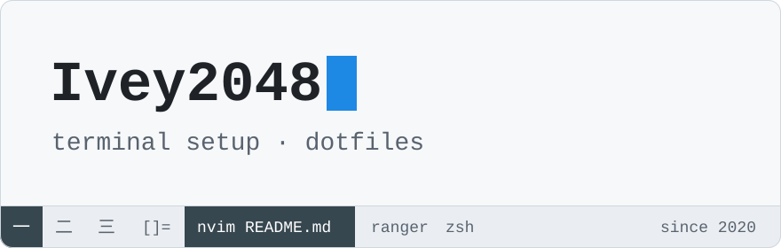

  <picture>
    <source media="(prefers-color-scheme: dark)" srcset="assets/header-dark.svg">
    <source media="(prefers-color-scheme: light)" srcset="assets/header-light.svg">
    
  </picture>

A terminal setup I've been tweaking since 2020. It started on Arch Linux with dwm; Neovim and ranger have stayed ever since.

- **2020** [archlinux](https://github.com/Ivey2048/archlinux) — Arch Linux dotfiles, including patched dwm and st sources.
- **2021** [nvim](https://github.com/Ivey2048/nvim) — full Neovim config: coc.nvim completion, UltiSnips snippets, telescope and fzf.
- **2024** [nvim-init](https://github.com/Ivey2048/nvim-init) — a minimal init.vim with no plugins.
- **2024** [ranger-init](https://github.com/Ivey2048/ranger-init) — ranger config with ueberzug image previews and git status.

The bar in the header is drawn from my 2020 dwm config.h: same colors, bar at the bottom, and the same Chinese-numeral tags.

<code>:wq</code>

